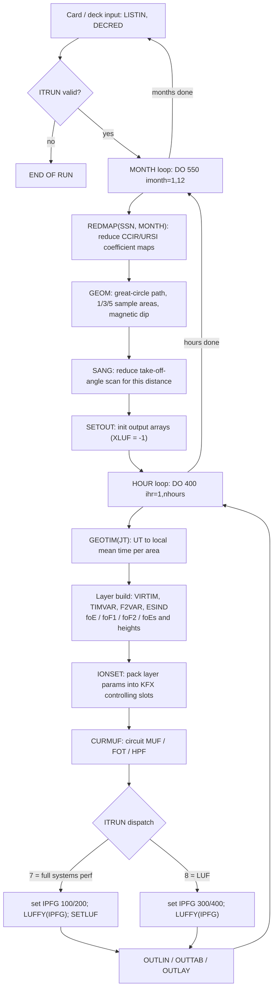
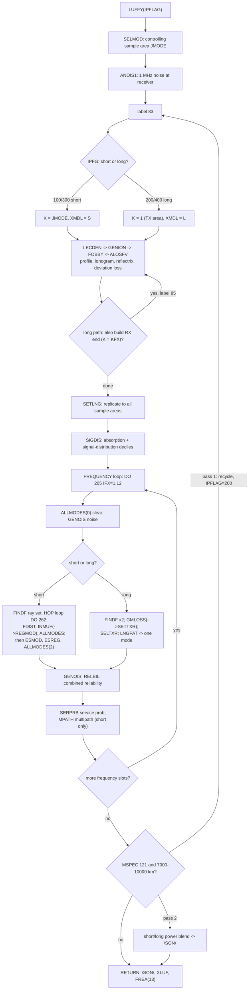

# How the original Fortran VOACAP works

This document describes the control flow of the vendored oracle in
`reference/voacapl/src/voacapw/`, read from the actual source — chiefly the
driver `hfmufs.for` and the system-performance engine `luffy.for`. It is the
program the GPU rewrite is validated against; the companion document
`architecture_gpu.md` describes the port.

> The `reference/` tree is no longer in the working tree (removed in commit
> `477dad7`). Restore it for reading with `git checkout 477dad7^ -- reference`.

## Its essential nature

VOACAP is **scalar and sequential**. One circuit (one transmitter/receiver
pair) is processed at a time, hour by hour, frequency by frequency. There is
no batching and no parallelism in the model: the whole state lives in Fortran
`COMMON` blocks that act as process-global variables, mutated in place as
control passes from routine to routine. `hfmufs.for` alone declares roughly two
dozen of them (`/DON/`, `/RON/`, `/MUFS/`, `/SON/`, `/FRQ/`, `/TIME/`,
`/ALPHA/`, `/CONTRL/`, ...). A routine "returns a value" by writing a `COMMON`
field its caller will later read.

Control flow is dense **GO TO** and **arithmetic-IF** (`IF(expr) L1,L2,L3`
branching three ways on sign). See `hfmufs.for` lines 203, 300, 313–325 for the
`ITRUN`/`ITOUT` dispatch, or `luffy.for` line 213 (`IF( DMAXKM(K) ) 122,122,123`).
Arithmetic is **REAL\*4** (32-bit float) throughout, with a handful of REAL\*8
spots (documented in `docs/precision_map.md` — 9 double-precision sites across
the codebase, e.g. the noise-power accumulators in GENOIS and the VERSY
coefficient basis). This scalar/global/GO-TO character is exactly what the GPU
port has to preserve bit-for-bit while turning it inside out for parallelism.

## The driver: HFMUFS

`HFMUFS` is the program-control subroutine. `ITRUN` selects the task (7 = full
systems performance, the path this project targets; 8 = LUF calculation; lower
values compute only ionospheric parameters, ionograms, or nomogram MUFs) and
`ITOUT` selects the output. The overall flow, reading top to bottom:

1. **Card / deck input.** `LISTIN` then `DECRED` parse the formatted control
   cards (the "deck") into the `COMMON` blocks — sites, method, frequencies,
   antennas, hours, months, SSNs. Invalid or exhausted input drives control to
   the end-of-run label.

2. **Month loop** (`DO 550 imonth=1,12`, line 107). For each requested month it
   sets `MONTH`/`SSN`, then:
   - **REDMAP(SSN, MONTH)** — reduce the CCIR/URSI coefficient maps for this
     month and sunspot number. This loads the big map tables (`FAM`, `DUD`,
     `FAKP`, `FAKMAP`, `HMYM`, `SYS`, `PERR`, ...) once per month; every hour
     reuses them.
   - **GEOM** — the circuit geometry. Computes the great-circle distance and
     bearings (with the NPSL long-path / through-antipode option), lays out the
     **1, 3, or 5 ionospheric sample control areas** along the path, gives each
     its geographic and geomagnetic coordinates and magnetic dip/gyrofrequency
     (via MAGVAR), and sets per-area ground constants. `KM` (the sample-area
     count) is fixed here.

3. **Frequency-set loop** (`DO 540 ifr`, line 130) and frequency counting, then:
   - **SANG** — reduce the take-off-angle scan table for this path length (a
     shorter path needs only high angles).
   - **SETOUT** — initialise the output arrays (notably `XLUF(:) = -1`, a preset
     the system-performance arm never overwrites, which matters later).

4. **Hour loop** (`DO 400 ihr = 1,nhours`, line 181). This is the heart of the
   driver. For each requested UT hour:
   - **GEOTIM(JT)** — convert UT to local mean time at each sample area.
   - **The layer-parameter build.** Using the REDMAP coefficient maps, a small
     chain turns the month/hour/geography into the critical frequencies and
     heights of each ionospheric layer: **VIRTIM** (UT variation of the critical
     frequencies and F2 M(3000)), **TIMVAR** (local-mean-time dependence, E and
     F1 parameters), **F2VAR** (F2 parameters, which can adjust F1), and
     **ESIND** (sporadic-E parameters). The result is `foE`, `foF1`, `foF2`,
     `foEs` and their heights/semithicknesses for every sample area. (Which of
     these run is gated by `KRUN`, the coefficient-model selector.)
   - **IONSET** — consistency-check the layer parameters and pack them into the
     `KFX` "controlling" slots (E layer from the nearer sample area, F from the
     further), zeroing an F1 layer that has merged into E or F2.
   - **CURMUF** — the circuit MUF and FOT. Builds the controlling area's
     electron-density profile and, layer by layer (E, F1, F2, Es), solves the
     oblique MUF by the secant law with a Martyn virtual-height correction
     iterated to 0.1 MHz. The circuit MUF is the max over E/F1/F2; FOT and HPF
     are the lower/upper decile envelopes. Written to `/MUFS/`.
   - **The ITRUN dispatch** (line 203). For `ITRUN = 7` (full systems
     performance) it sets the frequency complement (`FRQCOM`, or `FREL(12)` from
     the circuit MUF), chooses the **path model flag `IPFG`** — 100 forces the
     short-path model, 200 forces the long-path model, and the choice depends on
     `METHOD`/`MSPEC` and whether `GCDKM >= GCDLNG` (the long-path threshold) —
     then calls **LUFFY(IPFG)** and **SETLUF**. For `ITRUN = 8` (LUF) it calls
     LUFFY with `IPFG` 300 (short) or 400 (long).

5. **Output** (`OUTLIN` / `OUTTAB` / `OUTLAY` per hour; `OUTMUF` / `OUTGPH`
   after the hour loop) and loop back for the next hour, frequency set, month,
   and finally the next input card.

## Inside LUFFY

`LUFFY(IPFLAG)` (`luffy.for`) computes one hour of system performance — signal,
noise, and reliability at every frequency — for one circuit. `IPFLAG` selects
the model: **100** short-path system performance, **200** long-path, **300**
short-path LUF, **400** long-path LUF. It has three phases: a one-time SETUP, a
FREQUENCY loop, and (for METHOD 30 in the 7000–10000 km band) a smoothing blend.

### The SETUP phase (once per hour)

Before the frequency loop, LUFFY builds the machinery every frequency will
reuse:

- **SELMOD** picks the controlling sample area (`JMODE`).
- **ANOIS1** gets the atmospheric noise value at 1 MHz at the receiver site
  (driving the full NOISY 1–6 series on first use).
- The **ionosphere / reflectrix build**: **LECDEN** (electron-density profile)
  → **GENION** (the ionogram: 30 vertical sounding frequencies with their true
  and virtual heights) → **FOBBY** (the reflectrix table `IFOB`, oblique
  frequency in integer kHz by the secant law) → **ALOSFV** (the deviative-loss
  factor `AFAC`). For the **long path** this runs *twice* — once for the
  transmitter-end area (`K=1`) and once for the receiver-end area (`K=KFX`,
  reached at label 85) — because over 10,000 km the two ends sit in different
  places, local times and often hemispheres, so there is no single controlling
  ionosphere. Labels 83/84/85 (lines 105–139) implement this two-ended select.
- **SETLNG** replicates the computed area(s) across all the sample-area slots.
- **SIGDIS** sets the absorption-loss parameters and the signal-distribution
  deciles for the path.

### The FREQUENCY loop (`DO 265 IFX=1,12`, line 174)

For each of the 12 frequency slots (11 user frequencies plus the MUF), with
`IPFG` re-read from `IPFLAG` at the top of every iteration (line 179 — a quirk:
the setup may have raised it to 200, but the per-frequency body reverts to the
caller's value):

1. Preset `/SON/` for this slot and skip empty frequency slots
   (`FREL(IFX) <= 0. -> GO TO 265`).
2. **ALLMODES(0)** clears the mode accumulator; **GENOIS** computes the noise
   distribution at this frequency.
3. **The two path models** branch here:
   - **Short path** (IPFG 100/300): **FINDF** builds the ray set for this
     frequency, then the **HOP loop** (`DO 262 IHOP = IHSRT, IHSTP`, up to three
     hop counts) runs **FDIST** (up to six modes off the reflectrix), **INMUF**
     (insert the over-the-MUF mode; INMUF calls **REGMOD**, the per-mode loss
     budget), and **ALLMODES** (accumulate). After the hop loop, **ESMOD** and
     **ESREG** add the sporadic-E slots, then **ALLMODES(2)** accumulates them.
     The number of hops swept is derived from the ray table's maximum and skip
     distances (lines 220–230).
   - **Long path** (IPFG 200/400): **FINDF** is called twice (one ray table at
     each end), **GMLOSS** (→ **SETTXR**) prices all 45 rays at both ends,
     **SELTXR** picks one ray per end, and **LNGPAT** joins the pair into a
     single mode written straight into `/allMODE/` slot 1. No hop loop, no
     `/ZON/` accumulation, exactly one mode per frequency.
4. **The noise / reliability chain**: **GENOIS** again (combined), **RELBIL**
   (the combined signal-vs-noise reliability from the accumulated modes),
   **SERPRB** (service probability, if the output flag calls for it), and
   **MPATH** (multipath probability — short path only; the long path instead
   sets the receiver-end angle from LNGPAT's mode).

On the LUF arms (IPFG ≥ 300) the loop instead tests each frequency's
reliability against the required `PLUF`; the first frequency to make the grade
is interpolated into `XLUF` (label 165), and if none does, label 300 reports the
best frequency negated. (Two documented source quirks live here: label 300
never updates its running maximum `REL`, so it finds the *last* frequency that
beats slot 1, not the best — the source flags this itself in an inline comment;
and `IHMX`/`IXHP` are dead locals.)

### The smoothing blend (7000–10000 km, METHOD 30 / MSPEC 121)

For a path in the 7000–10000 km band, LUFFY runs the short path, then jumps back
to **label 83** with `IPFLAG` forced to 200 to run the long path over the *same*
SELMOD/ANOIS1 result (those two sit above label 83 and run once for both
models), saving each pass's `/SON/` columns into `(13,2)` temporaries. It then
**blends the two on power** (lines 415–522): `SMOOTH = SSPLD + 10*log10(DISINT*(10^(DELPOW/10) - 1) + 1)`,
where `DISINT = (GCDKM-7000)/3000` ramps from 0 at 7000 km (pure short path) to 1
at 10000 km (pure long path). If the long path is weaker the short path is taken
outright. Past 10000 km the driver forces the long-path model outright and no
blend occurs.

## Why this shapes the GPU port

Everything above is one circuit-hour of a long, branchy, **serially dependent**
program whose state is a wall of `COMMON`. VOACAP runs it once per circuit and
loops. The GPU rewrite keeps that program verbatim — the same GO-TO-derived
control flow, the same REAL\*4 rounding, the same documented quirks — but runs
one copy of it per thread so that tens of thousands of circuit-hours execute
concurrently. That transformation, and how it is validated bit-for-bit back
against this Fortran, is the subject of `architecture_gpu.md`.
