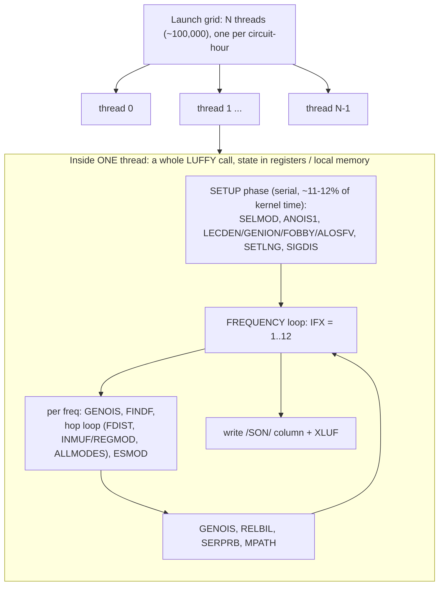
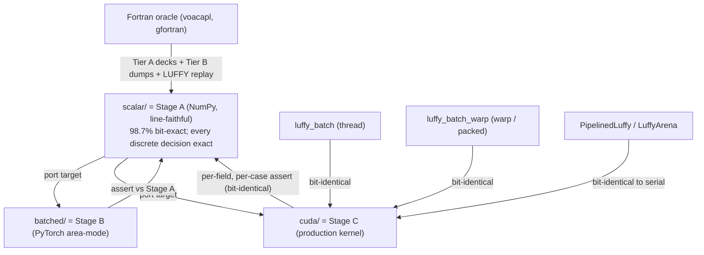

# How the GPU VOACAP works

This document describes the GPU rewrite of VOACAP in `src/voacap_gpu/`. It
assumes the Fortran original from `architecture_fortran.md`: a scalar,
sequential, `COMMON`-block program run one circuit-hour at a time. The rewrite's
job is to reproduce that program **bit-for-bit** while running tens of thousands
of circuit-hours at once on a GPU.

## Three implementations, three stages

The port exists in three forms, and all three are kept — each has a distinct
job. They map onto the project's commit-history "stages":

| Directory | Stage | What it is | Why it exists |
|---|---|---|---|
| `scalar/` | **Stage A** | Line-faithful NumPy transliteration of the Fortran, REAL\*4 semantics preserved | The **validation oracle**. Every Fortran-semantics question (NINT rounding, `COMMON` persistence, 1-based padding, dead locals, the documented quirks) is resolved here once, and it is validated bit-exact against the real Fortran. Everything else is checked against it. |
| `batched/` | **Stage B** | PyTorch area-mode port: whole lat/lon grids of ionospheric maps computed with batched tensors | The **area-coverage** path. It answers a different shape of question (a map of the ionosphere over a grid) using data-parallel tensor ops, and proved the physics ports to the GPU at all. |
| `cuda/` | **Stage C** | CUDA C compiled at runtime via NVRTC, **one thread (or warp) per circuit-hour** | The **production point-to-point engine**. This is the fast path a `predict()` call runs. |

The mapping is exact: `scalar` = Stage A, `batched` = Stage B, `cuda` = Stage C
in the commit log.

## The key idea of the CUDA path

Stage C compiles the Stage A control flow **directly as CUDA C `__device__`
functions**, one `.cuh` header per Fortran routine (~44 of them in
`cuda/kernels/`), composed into a single kernel where **one CUDA thread runs one
whole `LUFFY` call** — an entire circuit-hour — with its state in registers and
local memory. Contrast the Fortran, which runs exactly one circuit-hour at a
time: here roughly **100,000 circuit-hours run concurrently**, one per thread.

Two design constraints shaped this:

- **No compiler on the box.** There is no `nvcc` or MSVC installed. Everything
  compiles at runtime through **NVRTC** (shipped in the CuPy wheel), which
  compiles device code only — exactly what is needed, since kernels are launched
  from Python. `cuda/compile.py` pins the option set that *is the fidelity
  contract*: `--fmad=false` (NVRTC otherwise fuses `a*b+c` into an FMA, skipping
  the intermediate rounding and breaking bit-exactness on nearly every
  polynomial), plus `--prec-div=true --prec-sqrt=true`. A header fingerprint is
  injected into the source so editing any `.cuh` invalidates CuPy's kernel
  cache.

- **Bit-identity is the bar, not "close enough".** `cuda/CONVENTIONS.md` spells
  out the arithmetic discipline that keeps the CUDA C bit-identical to Stage A:
  every float literal is `f`-suffixed; transcendentals go through `f32math.cuh`
  (evaluate in binary64, round once to binary32, matching Stage A's `f32math`);
  Python `max`/`min` become `pymax`/`pymin` (NaN semantics: first argument
  wins); division by a compile-time constant goes through `div32`/`div64`
  because NVRTC strength-reduces it to a reciprocal multiply even under
  `--prec-div`; and expression *shape* (association order, `x*x` kept as a
  multiply, "pointless" double subtractions) is part of the answer.

`cuda/kernels/luffy.cuh` is the composed device function. It has the same three
phases as the Fortran LUFFY — a one-time setup, the `DO 265` frequency loop, and
the smoothing recycle — expressed as ordinary C helper functions
(`luffy_select_area_`, `luffy_short_path_`, `luffy_long_path_`,
`luffy_frequency_`, `luffy_after_loop_`). Because a device function cannot raise,
every place Stage A raises (on Fortran undefined behaviour) becomes a **non-zero
status** propagated back unchanged, with the state left exactly where Stage A
left it.

## The endpoint data flow

The public entry point is `predict(tx, rx, freqs, month, ssn, hours, antennas)`
in `src/voacap_gpu/engine.py` (under construction by another agent at the time
of writing; described here from the design). It composes the host-side setup
chain with the GPU kernel:

1. **Host setup chain.** The month/geometry/per-hour work that the Fortran
   driver does before LUFFY runs on the host in Stage A: **GEOM** and **SANG**
   once per path, then per hour **GEOTIM**, the layer build, **IONSET**, and
   **CURMUF**. This produces one Stage A **`Circuit`** state per circuit-hour —
   the bundle of 15 `COMMON`-block sub-states plus per-circuit scalars.

2. **Pack the measured input set.** A whole `CircuitState` is **55,652 bytes**,
   but almost all of it is scratch that LUFFY fills itself (`/RAYS/` `IFOB`
   alone is 30,504 bytes — 55% — and is pure scratch). Only **3,228 bytes** are
   read before being written; those are the `UPLOAD_FIELDS` in `cuda/driver.py`,
   established experimentally by zeroing each field across all 504 replay
   circuit-hours and diffing the output. The pack (`pack_circuit`) crosses only
   those. `/RAYS/` travels in its own **structure-of-arrays** device buffers
   (element `o` of thread `t` at `o*n + t`), because carried inside
   `CircuitState` its 55,652-byte stride made a warp-wide read of one float cost
   32 memory transactions — measured at 34 GB/s versus 2,892 GB/s once
   transposed. Read-only shared tables (the REDMAP coefficient maps and the
   antenna patterns) move **once** and each thread gets an index into them.

3. **The CUDA kernel.** `luffy_batch` launches one thread per circuit-hour
   (`luffy_batch_warp` is the warp-per-circuit-hour variant — see below). Each
   thread runs the whole LUFFY call over its own `CircuitState`.

4. **Fetch results.** Only **1,700 bytes** per circuit-hour come back
   (`RESULT_FIELDS`): `/SON/` (the per-frequency results table), `/MUFS/` `XLUF`
   (the LUF by hour), `/FRQ/` `JMODE` (which sample area controlled the path),
   plus the status word. `fetch_results` gathers those scattered words into one
   compacted block and does a single device-to-host copy, yielding a
   `LuffyResults` of structured MUF / LUF / signal / reliability.

```mermaid
flowchart LR
    subgraph HOST["Host — Python / NumPy (Stage A setup)"]
        direction TB
        P["predict(tx, rx, freqs, month, ssn, hours, antennas)"]
        SC["setup chain: GEOM / SANG / per-hour GEOTIM / IONSET / CURMUF"]
        CIRC["Circuit states, one per circuit-hour"]
        PACK["pack INPUT SET only: 3,228 of 55,652 B/thread<br/>shared REDMAP + antenna tables moved once"]
        P --> SC --> CIRC --> PACK
    end
    PACK -->|"H2D scatter, 3,228 B/thread"| GPU
    subgraph GPU["GPU — CUDA, compiled at runtime by NVRTC"]
        K["luffy_batch: one thread per circuit-hour<br/>(luffy_batch_warp for small batches)"]
    end
    GPU -->|"D2H gather, 1,700 B/thread"| UNPACK["fetch_results -> LuffyResults"]
    UNPACK --> OUT["structured MUF / LUF / signal / reliability"]
```

## The one-thread-per-circuit-hour model

Inside a single thread, the whole LUFFY program runs to completion: the serial
setup phase, then the frequency loop with its inner hop loop and noise chain.
Nothing about the per-thread code is data-parallel — it is the scalar Fortran,
transliterated. Parallelism comes entirely from launching one such thread per
circuit-hour and letting the hardware hide each thread's long dependency chain
behind thousands of independent others.

## The three kernel variants, and when each wins

Measured in `tools/bench_stage_c.py` (kernel-only, batch already resident):

- **thread** (`luffy_batch`): one thread per circuit-hour, 168 registers. Wins
  at and above full occupancy — once there are enough independent circuit-hours
  (roughly **> 8,000**) the machine hides each thread's dependency chain and no
  shorter chain is needed. At 32,256 threads it reaches **0.40 µs/eval** and at
  129,024 **0.268 µs/eval** — throughput is still climbing at 129k rather than
  saturating.

- **warp** (`luffy_batch_warp`): one warp per circuit-hour, lane L on frequency
  L+1, so the twelve `DO 265` trips run side by side over one ionosphere. It
  *shortens the dependency chain itself* and wins **below full occupancy** — up
  to **5.8×** the thread kernel at 504 circuit-hours on an empty machine. But it
  gives up 20 of 32 lanes (12 frequencies) and costs 254 registers against 168,
  so it loses once the thread kernel is saturated. The crossover is around
  **8,000 circuit-hours**. The setup phase does not parallelise across the lanes
  (11–12% of the kernel), which caps the design at ~5.2–5.4×.

- **packed** (`groups=2`, warp kernel with `VC_WARP_GROUPS=2`): two
  circuit-hours share one warp, 16 lanes each, lifting lane utilisation from
  12/32 to 24/32 and moving the crossover against the thread kernel a long way
  right. `bench_stage_c.py --warp` A/Bs all three.

Neither warp kernel replaces the thread kernel; the driver picks per batch size.
Notably, the measurements record what is **not** the bottleneck (all negative
results): occupancy/register pressure is flat, warp divergence between the three
propagation models is worth only 1.06×, and converting `/RAYS/` to
structure-of-arrays bought only 1.03× on the kernel — because the kernel is not
bandwidth-bound, it is bound by *its own serial dependency chain, which is the
program*.

### PipelinedLuffy and the PCIe reduction

`fetch_results`/`upload="inputs"` already cut the bus traffic from 55,652 to
3,228 bytes up and 1,700 back — a **5.2×** reduction on the transfer at 32,256
circuit-hours (`bench_stage_c.py --trip`). On top of that:

- **`LuffyArena`** allocates the device buffers and shared tables once and
  reuses them across submissions, never re-zeroing between batches (safe for the
  same reason the input-set reduction is safe: nothing outside `UPLOAD_FIELDS`
  is read before it is written).
- **`PipelinedLuffy`** splits a large workload into fixed-size chunks and
  overlaps the five stages (host gather, H2D, kernel, D2H, unpack) of adjacent
  chunks across `nstreams` CUDA streams with per-slot events and page-locked
  host buffers — no `deviceSynchronize` in the steady-state loop. The ragged
  final chunk is padded up by repeating real input rows (never zeros — a zeroed
  `layers.km` hangs the area loop). It is bit-identical to the serial arena.
- **`fast_math`** is an opt-in flag selecting the native-f32 libm in
  `f32math.cuh`. It is **not** bit-exact against Stage A (99.34% of cells exact,
  and — importantly — *no discrete decision moves*, pinned by
  `test_fastmath.py`), so it is off unless asked for.

### Measured head-to-head

The Fortran baseline is measured, not assumed (`tools/results/fortran_baseline.md`):
`voacapl` on a 32-core box is **16.68 ms/circuit** on one core and **0.97 ms/circuit**
on 32 cores (sub-linear 17× scaling, because each circuit is a separate process
and process spawn does not parallelise — this is the honest whole-machine
competitor). Per circuit-hour that is 0.695 ms (1 core) and 0.040 ms (32 cores).

`tools/real_world_compare.py` times whole-workload wall-clock (host gather + both
PCIe legs + kernel) for **161,280 circuit-hours**:

| Configuration | Wall-clock | vs Fortran 32-core |
|---|---|---|
| GPU pipe + fast-math (not bit-exact) | **~422 ms** | **~15×** |
| GPU pipelined (bit-exact) | **~724 ms** | **~9×** |
| Fortran 32 cores | ~6,518 ms | 1× |
| Fortran 1 core | ~112,000 ms | — |

So the production GPU path is roughly **15× a 32-core box** with fast-math, and
about **9× bit-exact** — against 1 core, hundreds of times faster. (Kernel-only,
the thread kernel is 66× one Fortran core at 32k threads and 97× at 129k; divide
by 32 for the whole-machine comparison.)

## The validation story

Correctness rests on a **three-tier** structure and one transitive chain:

1. **Tier A** — oracle-verified end-to-end decks: a golden matrix of ~99 decks
   (paths × months × SSN × method) run through the real Fortran.
2. **Tier B** — per-routine golden dumps: each routine's inputs/outputs captured
   from the instrumented Fortran, and the Stage A port checked cell-for-cell
   against them.
3. **Tier C / replay** — the whole LUFFY call captured (entry state → exit
   state) from the real program and replayed through the port.

The chain that makes the fast path trustworthy:

- **Stage A is 98.7% bit-exact against the real Fortran** — the final replay is
  21 decks × 24 hours × 262 columns = 132,048 cells, **98.705% bit-exact**
  (short-path 98.65%, long-path 99.03%, smoothing 98.42%). Crucially, **every
  discrete decision is exact on every cell** — mode selection, hop count (`NHP`),
  layer choice, and `JMODE` never differ; the discrete columns are asserted with
  *no tolerance*. The residual is entirely the documented f32 libm floor,
  bisected to FOBBY's `IFOB = 1000*FREQ` truncation to integer kHz amplified by
  FINDF's interpolation slope — not a logic error.
- **The CUDA kernel is bit-identical to Stage A** — per output, per case. Both
  sides evaluate transcendentals in binary64 and round once to binary32, so
  there is no libm gap between them; a non-bit-exact cell is treated as a
  porting bug until proven a genuine CUDA-vs-numpy binary64 divergence. Each
  Stage C leaf has a `tests/cuda/test_<name>.py` that computes expected values
  by calling Stage A in-process on the same cases and asserts bit-identity, and
  `test_luffy_replay.py` holds the whole composed kernel to it.
- **The kernel variants agree with each other**: `luffy_batch_warp` is
  bit-identical to `luffy_batch` on all 504 replay circuit-hours, and the
  pipelined path is bit-identical to the serial arena.

Transitively: the production CUDA kernel gives the same answer as Stage A, which
gives the same answer as the Fortran to 98.7% of continuous cells and 100% of
every discrete decision.

## Summary

The GPU rewrite does not re-derive VOACAP; it transliterates the exact scalar
Fortran three times over. Stage A pins the semantics against the oracle, Stage B
handles area-mode grids in PyTorch, and Stage C compiles the scalar program as
CUDA C and runs one copy per thread — ~100k circuit-hours at once — moving only
the 3,228 input bytes and 1,700 result bytes that matter across PCIe. The result
is roughly an order of magnitude faster than a 32-core Fortran box while staying
bit-identical to the reference that is itself 98.7% bit-exact to the original.
